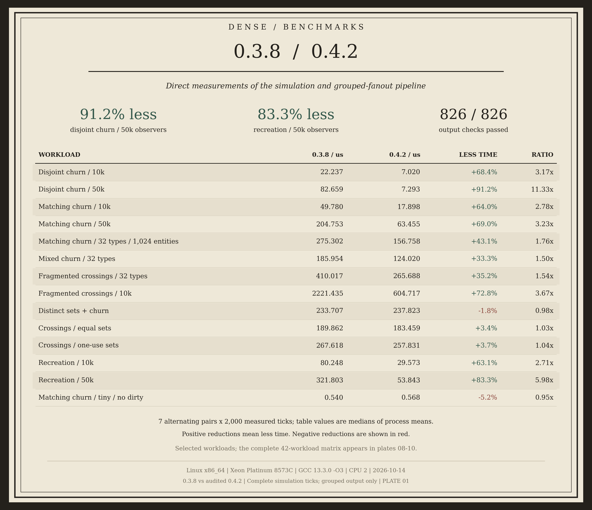
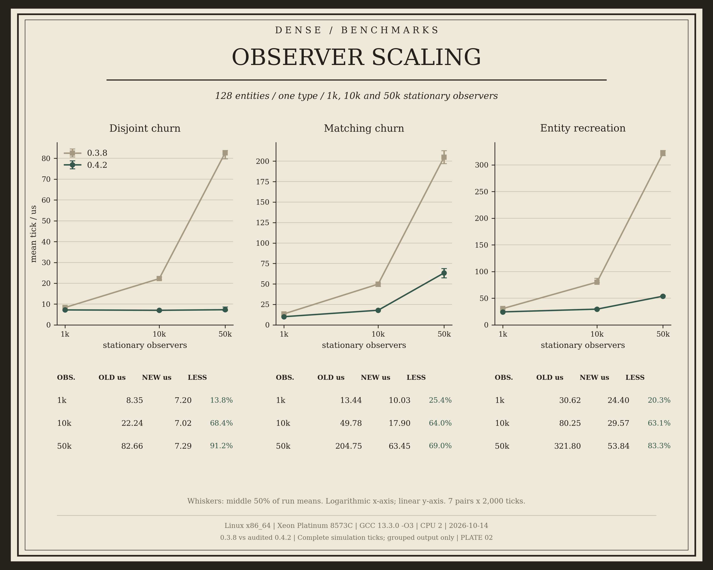

<p align="center">
  
</p>

# Dense | Current release: 0.4.2

**A high-density multiplayer server library family in C.**

Dense is a library family for deterministic multiplayer systems that must remain efficient when large numbers of players, NPCs, projectiles, timers, paths, collision bodies, and replication recipients gather in the same area.

Dense is not a complete game server. It provides explicit modules for simulation, transport, scheduling, collision, navigation, AI, and durable state. Public module boundaries remain separate.

This release repository contains Linux x86-64 shared and static libraries,
CPython 3.11-3.14 wheels, public C headers, documentation, and full Python,
C++, and Rust wrapper source. Core C implementation source is not included.

## Modules

| Module | Responsibility |
|---|---|
| `libdense_sim` | Entity lifecycle, validated positions, spatial membership, dirty state, canonical fanout views, and optional recipient worksets |
| `libdense_net` | Sessions, transport, reliability, queueing, and replication transport that consumes simulation fanout |
| `libdense_sched` | Tick phases, timing wheel, budgets, fairness, token buckets, and the shared overload ladder |
| `libdense_collision` | Authoritative integer collision, broadphase, movement validation, queries, and triggers |
| `libdense_nav` | Sparse navigation grids, deterministic paths, flow fields, caches, and collision rasterization |
| `libdense_ai` | Deterministic agent memory, behavior trees, scheduler-sliced execution, and intent production |
| `densedb` | Single-writer state tables, WATCH views, WAL durability, snapshots, and recovery |

## Authority and dependency direction

```text
dense_core (private, statically merged into each library)
    ^
    |-- libdense_sim
    |-- libdense_net
    |-- libdense_sched
    |-- libdense_collision
    |-- libdense_nav
    |-- libdense_ai
    `-- DenseDB
```

The intended server pipeline is:

```text
input
  -> validate
  -> nav proposal
  -> collision validation
  -> simulation commit
  -> combat / AI intent processing
  -> simulation fanout
  -> network flush
  -> DenseDB flush seam
```

`libdense_sim` is the sole authority for replication grouping. `libdense_net`
consumes borrowed fanout views and does not independently scan entities or
decide visibility groups. Optional recipient worksets derive from the same
finalized chunk/type membership. AI produces intents rather than mutating
authoritative game state directly.

## Benchmarks

The 0.4.2 comparison against 0.3.8 covers 47 simulation workloads, with seven
paired runs per condition on the same Linux host. Selected mean tick-time
reductions are 91.2% for the 50,000-observer disjoint case, 74.5% for the
32-type 10,000-observer churn case, and 83.8% for the longer 50,000-observer
entity-recreation control. These improvements depend on the workload: the
10,000-entity all-to-all mean is unchanged, and several small controls regress.

[Results, methodology, and all ten plates](docs/BENCHMARKS-0.4.2.md) include
the complete comparison, memory costs, allocation growth, and tail timings.
[Raw samples and summaries](release/benchmarks/0.4.2/) are included.

<p align="center">
  
  
</p>

### 0.3.8 module benchmarks

Results recorded on 2026-09-11 with `make benchmark` and the release `-O3`
build. [Benchmark output](release/benchmarks/benchmark-0.3.8-2026-09-11.txt)
and a [machine-readable summary](release/benchmarks/BENCHMARK_SUMMARY.json)
are included. See [benchmark scope](docs/BENCHMARK-SCOPE.md) for workload and
timing definitions.

<p align="center">
  
  
  
  
  
  
</p>

### libdense_sim

| Benchmark | Result |
|---|---:|
| Spawn with spatial insertion (1M entities) | 5,752,975 entities/s |
| Entity lookup (1M entities) | 59,908,030 lookups/s |
| Same-cell movement (100k entities) | 49,983,259 moves/s; 2.001 ms mean |
| Chunk-boundary thrash (20M crossings) | 15,671,016 moves/s; 6.381 ms mean |
| Dirty mark, public first-mark (1M entities) | 41,349,186 marks/s |
| Dirty mark, direct slot | 320,640,360 marks/s |
| Next-tick dirty reset | 913,799,485 entities/s |
| Recipient workset, source enqueue (100 visible of 2,000 recipients) | 3,022.899 ns/source; zero steady-state growth |
| Same source with a full recipient scan | 11,891.991 ns/source |
| Stable kinetic plans (2,000 entities), relative to sampled core/public paths | 0.65x / 0.49x time |

| Tick workload | Mean (ms) | p50 (ms) | p95 (ms) | p99 (ms) |
|---|---:|---:|---:|---:|
| Shared fanout: 1,000 entities and 1,000 observers | 0.027 | 0.029 | 0.029 | 0.046 |
| 8-way type-mask fragmentation: 1,000 entities and 1,000 observers | 0.027 | 0.027 | 0.027 | 0.045 |
| 10,000 observers, same coverage | 0.160 | 0.156 | 0.179 | 0.353 |
| 10,000 observers, boundary shift | 2.932 | 2.859 | 3.194 | 5.027 |

The shared fanout plan contains 1,000 entries and 1,000 subscriber references
representing 1,000,000 entity deliveries. These figures measure plan
construction; network transmission is measured separately.

### libdense_net

| Benchmark | Result |
|---|---:|
| Replication publish, encode + references (65,536 recipient-frames/tick) | 0.332 ms/tick; 10.1 ns/recipient-frame |
| Session flush | 0.377 ms/tick; 11.5 ns/recipient-frame |
| Shared fanout vs per-recipient sends, including flush | 1.89x faster |
| Implied deliveries | 92,358,906/s |
| Session lookup (5,000 sessions) | 4.64 ns/op |
| Flush-all visit cost (5,000 sessions) | 56.11 ns/session |
| Adverse soak: 20% drop, 8% duplicate, 12% reorder | 20,000/20,000 reliable commands delivered in order |

### libdense_sched

| Benchmark | Result |
|---|---:|
| Timer schedule (1M timers) | 6.2 ns/op |
| Timer cancel | 12.8 ns/op |
| Advance + fire | 65.1 ns/fired timer |
| Named 7-phase pipeline telemetry | 94.90 ns/tick; 55.81 ns overhead |
| Overload scenario (18 ms offered, 10 ms budget) | 14.25 ms worst tick; 13 escalations and 13 recoveries |

### libdense_collision

| Benchmark | Result |
|---|---:|
| Validated move, slide + bodies + commit + triggers (2,000-body crowd) | 198 ns/move; 5.05 M moves/s |
| Swept circle against 400 statics and 1,500 bodies, 46.7% hit rate | 671 ns/sweep; 1.49 M sweeps/s |

### libdense_nav

| Benchmark | Result |
|---|---:|
| Raw A* (256x256, about 22% walls) | 1,127.5 us/path |
| Cached path reuse, 96.2% hit rate | 44.1 us/path |
| Close requests: line of sight / full A* | 28.036 / 766.483 ns/request |
| Bounded repath lane, 300 requests | At most 2,048 expansions/tick across 2,571 ticks |
| Long route, 512x512 world: hierarchy / full tile A* | 0.015 / 53.723 ms |
| Hierarchical route work | 59 local + 14 graph expansions; 221,817 full tile expansions |
| Flow-field build, 256x256 | 16.28 ms |
| Flow steering, 10,000 agents over 100 ticks | 7.3 ns/agent-step |

### libdense_ai

| Benchmark | Result |
|---|---:|
| Perceive + threat + tree + intent, 10,000 agents sharing one tree | 67 ns/agent-tick |
| Whole-horde tick | 0.67 ms |
| Scheduler slices of 250 to 10,000 agents, 1M total agent-ticks | 6.45-6.57 ms total |

### Historical results

[Earlier benchmark tables and charts](docs/BENCHMARKS-2026-07-28.md) retain the
integrated authority loop, DenseDB, overload-policy, and dense-region scaling
measurements. Those workloads were not included in the 2026-09-11 run.

## Package layout

```text
libdense-0.4.2/
|-- README.md, CHANGELOG.md, VERSION, MANIFEST.md
|-- LICENSE.md, COMMERCIAL-LICENSE.md, SECURITY.md, SUPPORT.md
|-- install.sh, uninstall.sh, verify-release.sh, SHA256SUMS
|-- include/dense/          public C headers (9)
|-- lib/linux-x86_64/       Linux x86-64 shared + static libraries (7)
|-- pkgconfig/              pkg-config templates
|-- bindings/               Python, C++, and Rust wrappers (full source)
|-- docs/                   documentation and per-module references
|-- release/                ABI/API snapshots and benchmark records
`-- densebench/             benchmark charts
```

## Install

Verify the extracted release archive and install:

```bash
./verify-release.sh
sudo ./install.sh
```

The archive verifier excludes Git metadata. In a Git checkout, export the
release with `git archive` before running it. The shared-library bundle
requires Linux x86-64 with glibc 2.33 or newer.

Selected options (see `docs/INSTALLATION.md` for staging and packaging):

```bash
sudo ./install.sh --prefix /opt/dense
./install.sh --prefix /usr --destdir "$PWD/stage"
sudo ./uninstall.sh --prefix /opt/dense
```

Link with pkg-config:

```bash
pkg-config --cflags --libs libdense_sim
pkg-config --cflags --libs libdense_net
pkg-config --cflags --libs libdensedb
```

## Bindings

Binding source ships in full under `bindings/`; see `docs/BINDINGS.md`.

- **Python**: CPython 3.11-3.14 wheels for Linux x86-64, statically
  containing `libdense_sim`.
  `python3.14 -m pip install bindings/python/dist/*cp314*.whl`
- **C++**: header-only C++20 wrapper; `make -C bindings/cpp test`
- **Rust**: dependency-free wrapper crate; `make -C bindings/rust test`

## Determinism and memory policy

Dense targets a deterministic server as a function of initial state, ordered
inputs, configuration, and library versions. The family is gated on a
240-tick record/replay harness with per-tick checksums pinned across `-O3`
and ASan/UBSan builds, plus lifecycle and raw-frame audit logging
(`docs/determinism.md`, `docs/replay-and-audit.md`).

Live tick paths are prewarmed and retain high-water memory. A post-prewarm
growth operation is treated as a steady-state allocation and must be
observable in metrics and standing tests (`docs/performance-policy.md`).

## Documentation

Start at `docs/README.md`. Highlights:

- `docs/INSTALLATION.md` - native install, staging, and linker setup
- `docs/mmo-integration.md` - assembling the modules into one server loop
- `docs/architecture.md` - module boundaries and the authority pipeline
- `docs/modules/` - per-library reference notes
- `docs/BENCHMARK-SCOPE.md` - retained performance claims and exclusions
- `docs/PLATFORM-COMPATIBILITY.md` - supported platform, role, and ABI details

## License

See `LICENSE.md`, `COMMERCIAL-LICENSE.md`, and `SECURITY.md`. Binary
redistribution remains subject to the distribution conditions in
`LICENSE.md`.
